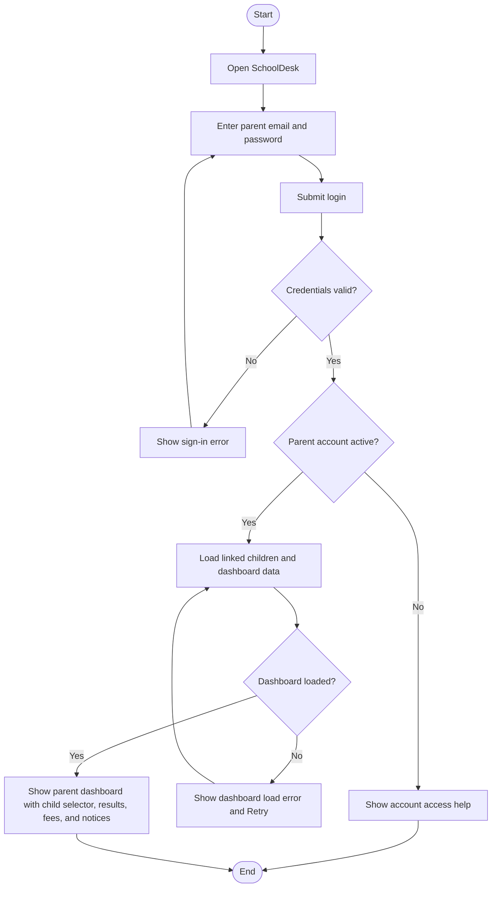
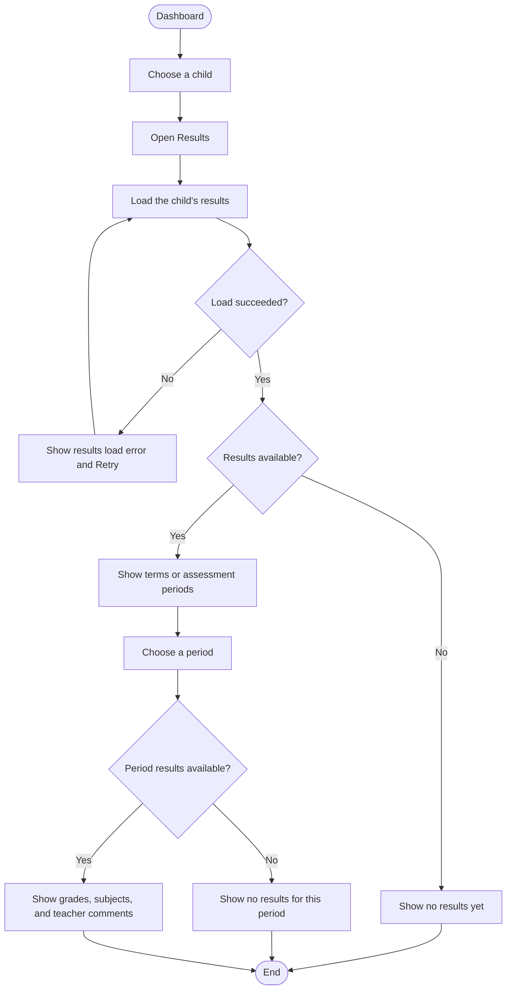
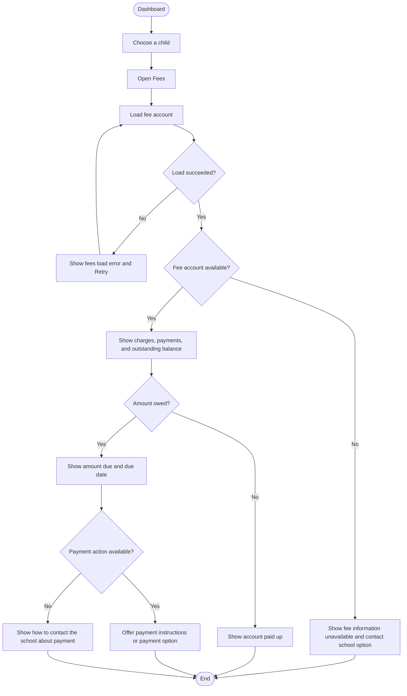
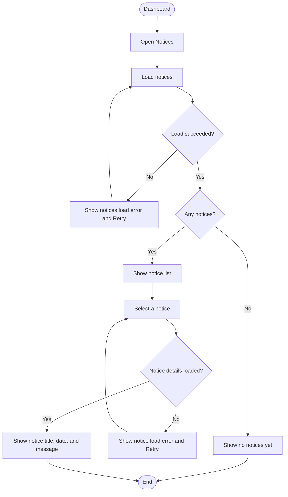

# Parent dashboard user flows

Feature 3: Parent dashboard for SchoolDesk fees, results, and notices.

## 1. Log in and land on the dashboard

## 2. View a child's results

## 3. Check school fees and amount owed

## 4. Read a notice

